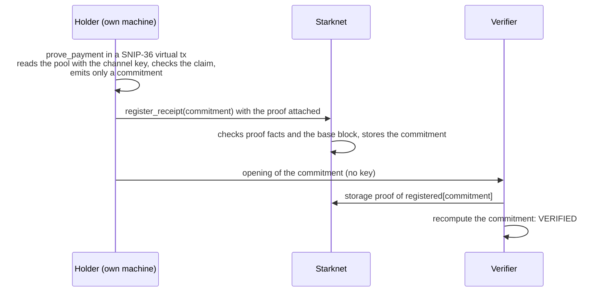

# strk20-receipts: Starknet Seed Grant proposal

## Summary

**STRK20 made payments on Starknet private. strk20-receipts makes them provable, one payment at a time.** A holder proves a single fact, such as "S paid R at least 1,000 USDC, reference INV-042", to anyone: an accountant, a landlord, an auditor, a grantor. The verifier gets no viewing key and no channel key, and checks the fact against Starknet itself.

It already runs end to end on Sepolia with a real SNIP-36 proof: [register_receipt transaction](https://sepolia.voyager.online/tx/0x2fbb82f04cd3959454d08f9bc55c39577f9c18130950b652032e6ec7031530e), produced by a [public CI run](https://github.com/sogolmalek/strk20-receipts/actions/runs/39253762056) anyone can repeat. We ask for **$19,000 in STRK over 3 months** to take it to mainnet as open-source infrastructure (Apache-2.0), integrate it into existing STRK20 apps, and publish the receipt format as a SNIP.

**Example.** A designer is paid monthly in USDC through PriPay, privately. Her landlord asks for proof of income. Today she can send PriPay's printed invoice, which the landlord cannot check, or the channel key she shares with her employer, which shows the landlord every salary payment, past and future. With strk20-receipts she sends one link: "this employer paid this address at least 3,000 USDC, reference PAYROLL-2026-09". The landlord's browser checks it against Starknet; nothing else about her pay is revealed, and the link cannot be used to read later payments.

## Why this matters for Starknet now

Privacy is Starknet's defining bet of 2026, and its promise is privacy that still works with compliance. That promise has a gap at the place most payments meet the real world: proving one payment to one person.

- **STRK20 is the flagship.** Nansen's H1 2026 report calls it a "singular strategic pivot" to a privacy-preserving execution layer. The pool has been live since June 9, 2026 through Ready and Xverse, with 18.17K deposits worth $3.22M so far ([L2BEAT](https://l2beat.com/privacy/projects/strk20)).
- **The official compliance layer serves regulators, not counterparties.** Viewing keys are encrypted to a master key held in a TEE by Financial Privacy Inc and opened only for authenticated lawful requests ([Starknet blog](https://www.starknet.io/blog/compliance-layer-onchain-privacy-strk20/)). A user cannot use it to show their accountant one invoice.
- **What users can hand over today is all or nothing.** A viewing key opens their whole history, and registration cannot be changed, so a shared key stays exposed for good (L2BEAT). A channel key opens every payment with one counterparty, past and future.
- **Proof of payment is routine in business.** Payroll, invoicing, rent, grants and B2B settlement all need it. StarkWare's [Private Payroll RFP](https://strk20.starknet.io/rfp/private-payroll) asks for income provable for taxes; StarkWare's own payroll app, [PriPay](https://github.com/starkware-industries/pripay), can only print an invoice the reader must take on trust.

| Disclosure path | Who starts it | What the other side learns | What they must trust |
| --- | --- | --- | --- |
| Auditor master key | A court or regulator, via Financial Privacy Inc | The scoped history the request covers | The TEE operator and its multisigs |
| Viewing key | The user | Every payment, past and future | Nothing, but privacy is gone |
| Channel key | The user | Every payment with one counterparty, forever | Nothing, but the relationship is exposed |
| PriPay invoice | The payer | One payment, as claimed | The issuer's word |
| **strk20-receipts** | **The user** | **One payment, or only that it was at least an amount** | **Starknet: a SNIP-36 proof and a storage proof** |

Receipts are the user-side half of STRK20 compliance. Without them, private payments stop where proof of payment begins, which is most of commerce.

## How it works

A receipt is a SNIP-36 proof that a note in the pool pays R from S with an amount meeting the claim, reduced to one public commitment.

The channel key only ever enters the locally proven virtual transaction. `register_receipt` accepts a commitment only if the proof facts contain this contract's own message for it, with a base block inside `proof_validity_blocks`. Claims are either the exact amount or a lower bound ("at least X"), and a holder-chosen reference such as an invoice id is bound into the commitment. No change to the pool contract is needed: every check reads storage the pool already writes.

## Live on Sepolia today

The full path runs on Sepolia with a real stwo proof: prove the payment, register the receipt on chain, verify it from the opening alone, and reject a tampered opening. Anyone can re-run it from the repository's [CI workflow](https://github.com/sogolmalek/strk20-receipts/actions/runs/39253762056); the whole run, including installing the prover, took 2 min 34 s.

| Evidence | Value | How to check it |
| --- | --- | --- |
| Receipt registered | [0x2fbb82f0…1530e](https://sepolia.voyager.online/tx/0x2fbb82f04cd3959454d08f9bc55c39577f9c18130950b652032e6ec7031530e), block 16,829,281, succeeded | The transaction carries proof facts; `registered_at(commitment)` returns 16,829,281 |
| Proof is the official virtual OS | Program hash `0x53f6c9…daa1` in the proof facts | Same hash the [SNIP-36 prover backend](https://github.com/starknet-innovation/snip-36-prover-backend) publishes for its Sepolia and mainnet runs |
| Proof is about this receipt | Message hash `0xb72f57…def2` in the proof facts | Recomputed independently from the contract's class hash and the commitment |
| Freshness | Base block 16,829,214, registered 67 blocks later | Contract enforces its validity window |
| Verification needs no key | CI verifies from the opening and a storage proof; an opening with the claim edited from 900 to 901 is rejected | [CI run](https://github.com/sogolmalek/strk20-receipts/actions/runs/39253762056) |

The Sepolia run reads a test pool seeded with StarkWare's public reference note, so the proof input holds no secret. Reads of the real pool are covered by the tests below; a receipt for a real pool payment is the first deliverable of M1.

| Component | What is shown | Checked against |
| --- | --- | --- |
| `PaymentReceipt` contract | 19 tests: exact and at-least claims; rejects wrong sender, channel key, token, missing note, false claim; registration rejects a missing, expired or foreign proof | StarkWare's real `Privacy` pool contract, seeded with StarkWare's Cairo reference vectors |
| Virtual transaction signing | INVOKE v3 hash and signature are bit-identical | snip36's own Rust implementation on the same inputs |
| Commitment and message hash | Identical in TypeScript and Cairo | Shared vector in both test suites, and the Sepolia proof above |
| Storage-proof verifier | Verifies storage to the block state root; rejects tampered nodes, wrong roots, wrong class hash | A recorded Pathfinder proof and live mainnet pool storage |

Total: 19 Cairo tests and 24 TypeScript tests; the TypeScript suite and the Sepolia run repeat in CI.

## Why it is ecosystem infrastructure, not an app

strk20-receipts is one contract and one SDK that every STRK20 product can call. It changes nothing in the pool, needs no trusted party, and turns a capability Starknet already has (SNIP-36 virtual blocks) into something users can feel.

- **A showcase for SNIP-36.** Receipts use virtual blocks for a job other than the pool's own actions: proving a fact about private state to a third party. It is a working, documented pattern other builders can copy.
- **One primitive, many products.** A "prove this payment" button for Ready and Xverse; verifiable payslips for PriPay and the Private Payroll RFP; proof of disbursement for grant programs, including the Starknet Foundation's own; invoice settlement proofs for B2B and OTC desks.
- **Completes the compliance story.** The protocol covers lawful requests; receipts cover the everyday ones. Together, Starknet can say a business can pay privately and still prove exactly what it must, to exactly whom it must.
- **A standard, not a silo.** The receipt and opening formats become a SNIP, so wallets and verifiers interoperate instead of each app inventing its own disclosure scheme.
- **Hard to build in-house for any single app.** It needs the pool's storage layout, the virtual OS, proof-fact checks and a storage-proof verifier to agree bit for bit. That shared work is what this grant funds once, for everyone.

## Landscape

No public project lets a user prove one STRK20 payment to a third party without handing over a key. The closest projects either reveal a whole relationship, or prove a fact only for payments made through their own contract, and several list per-payment proofs as future work.

| Project | What it discloses | Key handed over | Verified against |
| --- | --- | --- | --- |
| [STRK20 compliance layer](https://www.starknet.io/blog/compliance-layer-onchain-privacy-strk20/) | Scoped history, re-encrypted for an authority | None from the user; the master key opens it | A TEE operator and multisigs |
| [PriPay](https://github.com/starkware-industries/pripay) (StarkWare) | Printable invoice per payment | None, but nothing is provable | Trust in the issuer |
| [Lens](https://github.com/Techkeyy/lens) | Every payment in one relationship, one token | Channel key, reusable forever | Public RPC reads |
| [zkPayslip](https://github.com/EndPx/zkpayslip) | One fact, only for payroll run through its own contract; ZK binding listed as post-hackathon | None | Its helper contract, Sepolia only |
| **strk20-receipts** | **Any one payment in the pool, exact or a lower bound** | **None** | **SNIP-36 proof facts and storage proofs** |

Lens's own roadmap asks for bounded disclosure without a reusable key and a proof-of-payment button for other apps; strk20-receipts supplies both. Selective disclosure tooling is also IDEA-21 in the STRK20 Private Sprint idea list.

## Milestones and budget

Three monthly milestones inside the program's 3-month window, $19,000 in total, each ending in something anyone can check on chain or on GitHub.

| Milestone | Deliverables | Done when | Budget |
| --- | --- | --- | --- |
| M1 · Month 1 · Mainnet primitive | Receipt for a real Sepolia pool payment (week 1); hardened `PaymentReceipt` on mainnet; TypeScript SDK (`prove`, `register`, `verify`); local proving pipeline around the snip36 prover; receipt and opening format v1 | 3+ receipts registered on mainnet from real STRK20 payments; SDK published; tests public | $7,000 |
| M2 · Month 2 · Integrations | Verifiable proof-of-payment for PriPay (open PR); integration with a second app (Lens proposed); hosted verify page that checks an opening in the browser | PR opened on PriPay; second app shipping or merged; verify page live | $7,000 |
| M3 · Month 3 · Trust and standard | Storage-proof verifier as a library with an L1-anchored mode; draft SNIP for the receipt format; documentation and an integration guide | SNIP draft posted on community.starknet.io; verifier reproduces mainnet results in L1-anchored mode | $5,000 |

Most of the budget is engineering time, about 220 hours at $70 per hour; the rest pays for the infrastructure a mainnet receipt needs and an outside review before the format becomes a SNIP.

| Item | M1 | M2 | M3 | Total |
| --- | --- | --- | --- | --- |
| Engineering (about 220 hours) | $5,900 | $6,500 | $3,100 | $15,500 |
| Independent review of the contract and verifier | | | $1,500 | $1,500 |
| Proving machine: on-demand 32 GB VM under our control (the prover needs about 15 GB) | $300 | $100 | | $400 |
| RPC with historical storage proofs, mainnet and Sepolia | $200 | $200 | $200 | $600 |
| Mainnet fees: declares, deployments, test payments (4 STRK pool fee each), receipts | $600 | $200 | $200 | $1,000 |
| **Total** | **$7,000** | **$7,000** | **$5,000** | **$19,000** |

After the grant, the contract, SDK and verify page stay maintained and track pool upgrades; the pool contract was last upgraded on September 23, 2026 ([L2BEAT](https://l2beat.com/privacy/projects/strk20)).

## What success looks like after 3 months

- Receipts registered on mainnet from real STRK20 payments, with transaction hashes in the repository.
- At least two STRK20 apps calling the primitive: a PriPay pull request plus one more.
- A verify page where anyone pastes a receipt link and checks it in the browser, with no wallet and no key.
- The receipt format posted as a draft SNIP on community.starknet.io for wallet and app teams.
- All code Apache-2.0, with tests that run against StarkWare's own pool contract.

## Team

**Sogol Malek** ([GitHub](https://github.com/sogolmalek)), lead developer. Ethereum Foundation Core Developer Fellow, working on stateless light-client engineering, which is the background behind the storage-proof verifier. Built a production AI trading system at Xtreamly (about $90K MRR). Co-founder and CEO of Flowbit, a B2B financial intelligence platform, so payment reconciliation and audit workflows are her day-to-day domain. Harvard Blockchain Accelerator alumna. MSc in Electrical Engineering, RWTH Aachen.

## Risks and security assumptions

| Risk or assumption | Mitigation |
| --- | --- |
| The protocol must check each proof against the virtual OS program and a canonical base block | Same assumption the STRK20 pool's own `validate_proof` makes; no additional trust is introduced |
| SNIP-36 phase 1 privacy is de facto, not formal zero knowledge, and the prover sees its inputs, including the channel key | Proving runs locally with the snip36 prebuilt prover; hosted provers are never used for receipts |
| On chain, the commitment and the registering account are public | Only a blinded commitment is posted; registration can go through a paymaster or a separate account |
| A receipt proves a payment exists, not that no other payment exists | Stated in the receipt format and on the verify page, so verifiers do not over-read it |
| Verifiers reading through an untrusted RPC | Reads are checked by storage proofs; M3 adds an L1-anchored mode |
| Pool upgrades change storage layout | Slot derivations are tested against StarkWare's reference vectors and pinned to a pool version |
| The snip36 prover needs about 15 GB of memory, more than many laptops have | Measured on Sepolia: a standard 16 GB GitHub runner installed the prover, proved and registered a receipt in 2 min 34 s. Real channel keys are proven only on the holder's own machine; M1 documents the hardware and a self-hosted prover option |

## Links

| Item | Link |
| --- | --- |
| Repository (Apache-2.0) | [github.com/sogolmalek/strk20-receipts](https://github.com/sogolmalek/strk20-receipts) |
| Reproducible Sepolia run | [CI run 39253762056](https://github.com/sogolmalek/strk20-receipts/actions/runs/39253762056) |
| Registered receipt (Sepolia) | [0x2fbb82f0…1530e](https://sepolia.voyager.online/tx/0x2fbb82f04cd3959454d08f9bc55c39577f9c18130950b652032e6ec7031530e) |
| `PaymentReceipt` (Sepolia) | [0x7e38ced4…409d227](https://sepolia.voyager.online/contract/0x7e38ced4058d815fcabc776ef7e2880ae4b5b61bf01fd37f60fc5ec8409d227) |
| Test pool (Sepolia) | [0x50692e08…8b333](https://sepolia.voyager.online/contract/0x50692e08999c48c41ec09d73d56213f9cce016199e32541590a966635d8b333) |

## Sources

- [L2BEAT: STRK20 privacy pool](https://l2beat.com/privacy/projects/strk20), launch date, deposits, viewing-key model (as of 2026-10-19)
- [Starknet blog: the compliance layer for onchain privacy](https://www.starknet.io/blog/compliance-layer-onchain-privacy-strk20/), July 14, 2026
- [Nansen: Starknet H1 2026 report](https://nansen.ai/post/starknet-h1-2026-report)
- [STRK20 Private Payroll RFP](https://strk20.starknet.io/rfp/private-payroll) · [STRK20 privacy SDK](https://github.com/starkware-libs/starknet-privacy) · [SNIP-36 prover backend](https://github.com/starknet-innovation/snip-36-prover-backend) · [Seed Grants](https://www.starknet.io/grants/seed-grants/)
